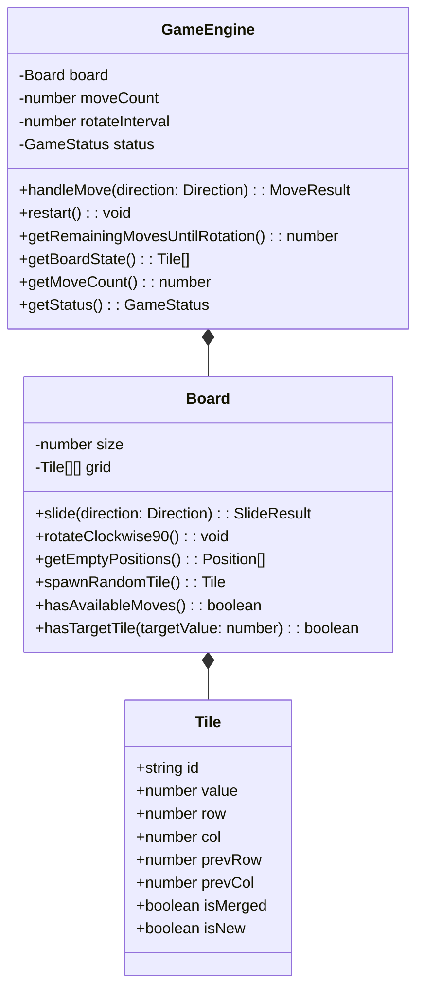

# 1024 스페셜 게임 (1024 Special Challenge) 설계 문서

## 1. 개요 및 기획 의도 (Intent & Why)
본 프로젝트는 기존 2048/1024의 누적 점수 경쟁 방식을 탈피하여, **"최소 이동 횟수로 1024를 완성하는 퍼즐 전략 게임"**을 개발하는 것을 목표로 합니다.
100번의 이동마다 보드 전체가 시계방향으로 90도 회전하는 독창적인 방해 요소를 도입하여 플레이어의 공간 지각 능력과 전략적 수 읽기를 요구합니다.
또한, 본 게임은 독립적인 웹 페이지로 동작함과 동시에 추후 다른 대규모 웹 서비스의 하위 모듈 또는 위젯으로 손쉽게 임베드될 수 있도록 설계됩니다.

---

## 2. 목표, 비목표, 실패 기준 (Goals, Non-goals, Anti-goals)

### 목표 (Goals)
1. **최소 이동 횟수 경쟁 시스템**: 1024 타일 생성 시 즉시 승리하며, 최종 이동 횟수(Moves)를 기록 및 표시.
2. **100턴 회전 방해 기믹 (90° Clockwise Rotation)**:
   - 매 100번째 이동 시 4x4 보드와 타일 좌표가 시계방향으로 90도 회전.
   - 플레이어 가독성을 위해 타일 내부의 숫자 텍스트는 정방향(0°) 유지.
   - 다음 회전까지 남은 횟수를 상단 게이지 바(Warning Progress Bar)로 시각화.
3. **모바일 최적화 UI (Option A: 아케이드 포커스)**:
   - 모바일 작은 화면에서도 가독성이 뛰어난 다크 테마 기반 반응형 레이아웃.
   - 터치 스와이프 제스처 및 키보드 방향키 동시 지원.
4. **객체지향 및 모듈화 아키텍처**:
   - 게임 상태, 보드 연산, 타일 생명주기를 클래스로 분리하여 유지보수성 극대화.
5. **Next.js 및 Firebase 배포 환경 준수**:
   - SSR(서버 렌더링)을 기본 셸로 하고, 실시간 인터랙션 보드는 유저 사이드(Client Component)로 분리.
   - API 키 및 서버 로직 비공개 보안 준수.

### 비목표 (Non-goals)
- 1024 달성 후 2048 이상 무한 모드로 계속 진행하는 기능 (사용자 요청에 따라 1024 달성 즉시 승리 종료).
- 복잡한 3D 그래픽 (2D CSS Transition 및 Tailwind 기반 간결하고 빠른 렌더링 지향).
- 무거운 외부 게임 엔진 라이브러리 사용 배제 (순수 TS 및 경량 모듈로 구현).

### 실패 기준 (Anti-goals)
- 모바일 화면에서 터치 스크롤과 게임판 스와이프가 충돌하여 화면이 흔들리는 현상.
- 회전 시 타일 내 숫자가 함께 기울어져 사용자가 고개를 돌려야 하는 불편함.
- 불필요한 번들 크기 증가 및 프레임 드랍.

---

## 3. 기술 스택 및 환경 제약조건 (Constraints)

| 구분 | 기술 / 설정 | 비고 |
| :--- | :--- | :--- |
| **언어** | TypeScript (Strict Mode) | 타입 안정성 및 인터페이스 명세 |
| **프레임워크** | Next.js (App Router) | SSR 셸 + `"use client"` 게임 뷰 |
| **스타일링** | Tailwind CSS | 모바일 반응형 및 다크 테마 |
| **배포 플랫폼** | Firebase (Firebase Hosting / App Hosting) | 간편하고 안전한 웹 호스팅 |
| **버전 관리** | Git / GitHub (https://github.com/jcodeonly) | 컴포넌트별 브랜치 분기 후 검토/머지 시 버전 태깅 |
| **참고자료 관리** | `reference/` 하위 폴더 | 핵심 문서 및 참조 스펙 보관 |

---

## 4. 핵심 게임 규칙 및 사용자 경험 상세 (How it gets made)

### 4.1 게임 흐름 (Game Flow)
1. **시작**: 4x4 그리드 상의 무작위 빈 셀 2곳에 2 또는 4 타일 생성 (2: 90%, 4: 10%). 이동 횟수: `0`.
2. **이동 (Move)**: 상, 하, 좌, 우 방향키 또는 스와이프.
   - 실제로 타일이 하나라도 움직이거나 합쳐진 경우에만 이동 횟수 +1.
   - 이동 성공 시 빈 공간에 새로운 2 또는 4 타일 1개 생성.
3. **100턴 회전 기믹**:
   - 이동 횟수가 100의 배수(100, 200, 300...)가 되는 순간 회전 발동.
   - 보드 좌표 변환: `(row, col) -> (col, 3 - row)` (시계방향 90도 회전).
   - 타일 엘리먼트 위치는 회전하나 숫자 텍스트는 `transform: rotate(0deg)` 유지.
4. **승리 판정 (Victory)**:
   - 타일 병합 결과 1024 타일이 생성되면 즉시 게임 승리 모달 노출.
   - 모달에 최종 이동 횟수 및 축하 메시지, '다시 도전' 버튼 제공.
5. **패배 판정 (Game Over)**:
   - 16칸이 모두 차고 상하좌우 어느 방향으로도 타일을 합칠 수 없으면 게임 오버 모달 노출.

### 4.2 레이아웃 구성 (Option A - 아케이드 포커스)
- **Top Bar**: STAGE 1024 타이틀, [MOVES: 58] 대형 스탯 카드, [BEST MOVES: 42] 최저 기록.
- **Rotation Gauge Bar**:
  - `⚠️ 90° 회전까지 [ N ]회 남음` 텍스트.
  - 진행률 게이지 바 (100회 주기로 0% -> 100% 증가, 임계 도달 시 경고 색상 강조).
- **Game Board**:
  - 4x4 정사각 반응형 그리드.
  - 타일 숫자별 색상(Tailwind 색상 팔레트) 및 병합/등장 팝업 애니메이션.
- **Bottom Bar**:
  - 모바일 터치 스와이프 안내 문구.
  - [새 게임] 버튼.

---

## 5. 아키텍처 및 객체지향 설계 (OOP Architecture)

유지보수 및 코드 재사용을 위해 핵심 로직을 클래스로 캡슐화합니다.

1. **`Tile`**:
   - 타일의 고유 ID(애니메이션 키 유지용), 숫자 값, 현재 좌표, 이전 좌표(`prevRow`, `prevCol`), 병합 여부 보관.
2. **`Board`**:
   - 4x4 매트릭스 슬라이딩 및 병합 로직 담당.
   - `rotateClockwise90()` 메서드를 통해 시계방향 90도 좌표 회전 수학 공식 수행.
   - 빈 공간 체크 및 게임 오버 판정 로직 통합.
3. **`GameEngine`**:
   - 전체 게임의 상태 머신 (`IDLE`, `PLAYING`, `WON`, `GAME_OVER`).
   - 100회 이동 감지 및 보드 회전 트리거 제어.
   - 1024 타일 감지 시 즉시 `WON` 상태 전환.

---

## 6. Git 브랜치 및 릴리즈 전략 (Version Control)
- **저장소**: https://github.com/jcodeonly
- **브랜치 분기 규칙**:
  - `main`: 프로덕션 배포 가능한 안정 버전.
  - `feat/game-engine`: 객체지향 엔진 클래스 및 단위 테스트.
  - `feat/board-ui`: 4x4 보드, 타일 렌더링, CSS 트랜지션.
  - `feat/controls-gesture`: 키보드 및 모바일 스와이프 인터랙션.
  - `feat/rotation-gauge`: 100턴 회전 카운트다운 게이지 및 연출.
  - `feat/modals-persistence`: 승리/패배 모달 및 로컬스토리지 최저 이동 기록 저장.
- **병합 및 버전 관리**:
  - 각 컴포넌트 브랜치 작업 완료 및 검증 후 `main`에 병합.
  - 병합 시마다 Semantic Versioning (v0.1.0 -> v0.2.0 -> v1.0.0) 태깅 및 버전 번호 증가.

---

## 7. 구현자 재량 사항 (Left to the Builder)
- 타일 이동 트랜지션 시간 미세 조정 (기본 150ms ~ 200ms 권장).
- 보드 회전 연출 시 CSS 회전 트랜지션과 타일 내부 역회전(-90deg)의 일치 타이밍.
- 로컬스토리지에 저장되는 최저 이동 횟수(Personal Best) 키 네이밍 및 초기화 기능.
